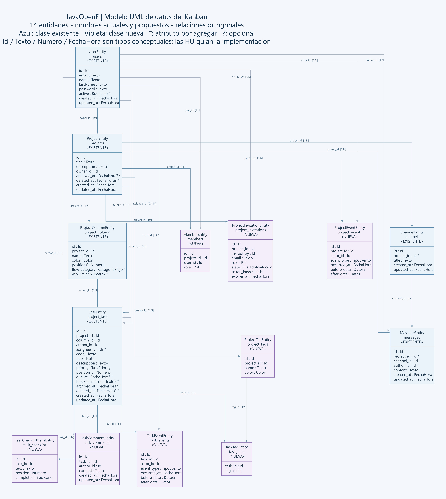

# JavaOpenF — Proyectos con memoria, aprendizaje y Kanban

Plataforma orientada a personas que quieren desarrollar un proyecto para su portfolio, aprender o construir una iniciativa propia. En el producto completo, el usuario explica su idea a un agente, obtiene especificaciones en Markdown, elige el nombre del proyecto desde la UI, crea y conecta un repositorio de GitHub o GitLab y organiza su desarrollo en un Kanban con planificación asistida.

El producto conserva el recorrido del desarrollo: tecnologías utilizadas, decisiones, desafíos, errores, intentos, soluciones y aprendizajes vinculados con el trabajo. Esa memoria permite guardar dónde se dejó el proyecto, retomarlo con contexto y preparar una presentación respaldada por evidencias. La oferta se plantea gratuita, con una base manual útil y una estrategia de asistencia de IA por concretar.

**La primera etapa es completar el Kanban P0 + P1.** Los agentes y la conexión de repositorios se desarrollarán después, reutilizando los proyectos, columnas, tarjetas y permisos de esa base.

**Finalidad del equipo: desarrollar y aprender.** Este README y las historias de usuario definen el negocio: qué necesita el usuario, qué puede hacer, qué reglas debe respetar el sistema y cómo comprobar cada funcionalidad. Los desarrolladores del equipo diseñan e implementan la solución y aprenden durante ese proceso. El modelo de datos sirve como referencia para ese trabajo; las decisiones de arquitectura, persistencia, gestión del esquema y herramientas corresponden al equipo.

## Alcance y responsabilidades

| Área | Responsable principal | Alcance |
| --- | --- | --- |
| Workspaces | Jair | Proyectos/tableros, columnas, tarjetas, movimiento y orden, miembros, permisos, etiquetas y seguimiento del flujo. |
| Cuentas y comunicación | Cristofer | Usuarios, autenticación, canales y mensajes; integración de identidad con workspaces. |
| Integración | Ambos | Diseñar e implementar juntos los contratos, la persistencia, las pruebas y la ejecución del sistema como parte del aprendizaje. |

**Workspace** es el nombre del módulo (`workspaces/`), no una tabla existente. Por ahora **un proyecto equivale a un tablero Kanban**. No se añade una jerarquía workspace → proyectos sin una necesidad concreta.

El estado visible de una tarjeta lo determina su columna. Las columnas iniciales ya definidas son **Por hacer → En progreso → En revisión → Finalizado**. No se añadirá un `task.status` que duplique ese estado; la clasificación de columnas para métricas se describe en el modelo propuesto.

## Qué significa terminar el Kanban

1. **P0 — Tablero operativo:** identidad y acceso, proyectos, lectura del tablero, columnas configurables, CRUD de tarjetas, movimiento/orden persistente, validaciones y API real.
2. **P1 — Kanban completo acordado:** colaboración con roles, responsables y etiquetas, filtros, límites de trabajo en curso (WIP), bloqueo, vencimientos, checklist, comentarios, archivo, historial y métricas, con pruebas de integración.
3. **P2 — Después del Kanban:** memoria del proyecto (tecnologías, desafíos e intentos, decisiones y aprendizajes, puntos de retorno), acompañamiento para retomar y avanzar, entrada desde una idea con especificaciones y GitHub/GitLab, y presentación basada en evidencias. P2 no amplía el cierre de P0 + P1.

Las historias `HU-00` a `HU-23`, con sus criterios de aceptación, están en [docs/HISTORIAS_USUARIO.md](docs/HISTORIAS_USUARIO.md).

**P1 también forma parte del cierre del Kanban**: no basta con cerrar P0. La interfaz y el arrastre de tarjetas se verificarán con el cliente que consuma la API; no hay frontend en este repositorio. Estas prioridades establecen el orden del alcance propuesto para este proyecto, no una lista universal de requisitos de todo Kanban.

El chat general se mantiene como módulo complementario. Crear o mover tarjetas no dependerá de crear canales. Los comentarios de tarjetas se planifican dentro de workspaces.

En esta primera etapa el usuario crea y gestiona su tablero manualmente. En la etapa asistida, los agentes usarán las mismas funcionalidades y reglas. La propuesta inicial de documentos es una especificación `SPEC.md`, el backlog en el Kanban y documentos opcionales de exportación y decisiones.

## Tecnología y estructura

- Java 21, Maven y empaquetado WAR (`open_f.war`) para Tomcat 10.1 (Jakarta Servlet 6.0).
- API REST con Jersey (JAX-RS) y Jackson; inyección de dependencias con HK2.
- Jakarta Persistence con Hibernate, HikariCP y MySQL 8.4.
- JWT para la sesión, BCrypt para las contraseñas y Logback para los logs.
- Monolito modular: un módulo por área de negocio, con las mismas cuatro capas en cada uno.

```text
src/main/java/com/open_f/fu/
  RestConfig.java         Arranque de la API (/api): une los módulos
  accounts/               Usuarios y autenticación (Cristofer)
  workspaces/             Proyectos, columnas y tarjetas (Jair)
  chats/                  Canales y mensajes (Cristofer)
  shared/                 Errores, transacciones, JWT y utilidades comunes

  <módulo>/
    api/                  Recursos JAX-RS (*Resource)
      request/            Records de entrada: bodies y @BeanParam
      response/           Records de salida
    service/              Casos de uso (*Service); abren la transacción
      command/            Records de entrada cuando un caso de uso recibe 4 valores o más
    domain/               Sin JPA ni HTTP
      model/              Agregados con sus reglas, enums y cálculos de dominio
      interfaces/         Puertos que implementan otras capas (*Repository, PasswordHasher)
      exception/          Excepciones de negocio
    persistence/
      entity/             Entidades JPA (*Entity)
      mapper/             Conversión entre entidad y modelo de dominio (*Mapper)
      repository/         Implementaciones JPA de los repositorios (Jpa*Repository)
    <Módulo>Binder.java   Inyección HK2: une interfaces con implementaciones
```

Cada capa se divide por tipo de clase y no por feature: dentro de cada carpeta de tipo los archivos van planos, sin subcarpetas. Un sub-recurso de la URL (por ejemplo `/project/{projectId}/members`) es un `*Resource` aparte con su `@Path` completo. Las carpetas de tipo existen solo si tienen archivos. La carpeta del paquete `interfaces` va en plural porque `interface` es una palabra reservada de Java.

Como `entity/`, `mapper/` y `repository/` son paquetes distintos, los constructores y setters de las entidades y los mappers son `public`. Por regla, solo los `Jpa*Repository` crean o modifican entidades, y siempre a través de su mapper. `service` y `api` trabajan solo con el modelo de dominio.

Cada repositorio JPA recibe por constructor su propio `EntityManager` y lo usa como `this.em`; las operaciones comunes (`findEntity`, `persist`) están en `shared/persistence/JpaRepository` y reciben ese `em`. El `EntityManager` inyectado es `TransactionalEntityManager`: un proxy que en cada llamada usa el `EntityManager` de la transacción abierta por `TransactionManager`, así varias llamadas a repositorios dentro de un mismo servicio comparten la transacción.

Cada capa traduce en su propio borde. `service` no importa nada de `api`: recibe valores sueltos, o un `*Command` de `service/command/` cuando son 4 o más, y devuelve objetos de dominio. El `*Resource` arma la entrada con los campos del request o con `XxxRequest.toCommand(...)`, y la salida con `XxxResponse.from(dominio)`. Los repositorios también devuelven objetos de dominio: la conversión con la entidad JPA la hace su mapper de `persistence/mapper/`.

Reglas de dependencia: `api → service → domain ← persistence`. `domain` no importa JPA ni HTTP. Un módulo usa a otro solo por su `service` (por ejemplo, `workspaces` llama a `UserService.exists`). Entre módulos se guardan ids (`owner_id`, `author_id`, `user_id`), no relaciones JPA. `shared` no importa ningún módulo. Los errores de negocio heredan de `shared/domain` y `ApiExceptionMapper` los convierte en `ApiError` (400, 401, 404, 409).

## Ejecución local

Requisitos: JDK 21, Maven, Docker Compose y un contenedor compatible con Jakarta Servlet 6.0, como Tomcat 10.1.

1. Iniciar MySQL desde la raíz del repositorio:

   ```sh
   docker compose up -d data_db
   ```

2. Revisar `src/main/resources/META-INF/persistence.xml`: BD `open_f`, puerto `3306`. Hay una URL JDBC con `[::1]` y otra de Hikari con `localhost`; confirmar que apunten a la misma instancia. Las credenciales actuales son de desarrollo y deben coincidir con Compose. Su externalización está pendiente.
3. Compilar el WAR:

   ```sh
   mvn clean package
   ```

4. Desplegar `target/open_f.war` en `webapps` de Tomcat e iniciar el servidor. El listener de `web.xml` inicializa la persistencia, y Hibernate crea o actualiza las tablas (`hbm2ddl.auto=update`).
5. Con Tomcat en el puerto habitual `8080`, registrar un usuario e iniciar sesión (rutas públicas):

   ```sh
   curl -X POST http://localhost:8080/open_f/api/users/register -H "Content-Type: application/json" -d "{\"email\":\"ana@test.com\",\"name\":\"Ana\",\"last_name\":\"Diaz\",\"password\":\"secreto123\"}"
   curl -X POST http://localhost:8080/open_f/api/users/login -H "Content-Type: application/json" -d "{\"email\":\"ana@test.com\",\"password\":\"secreto123\"}"
   ```

   El resto de rutas pide `Authorization: Bearer <token>`.

## Base de datos



El diagrama es una **guía UML de datos del Kanban completo y chats complementarios**, con 14 entidades: las seis clases existentes y ocho nuevas propuestas. Conserva `UserEntity/users`, `ProjectEntity/projects`, `ProjectColumnEntity/project_column`, `TaskEntity/project_task`, `ChannelEntity/channels` y `MessageEntity/messages`. Añade miembros, invitaciones, etiquetas, asociación tarea/etiqueta, checklist, comentarios e historial de tareas y proyectos.

Las conexiones usan segmentos horizontales/verticales; azul distingue clases existentes y violeta las nuevas. Un asterisco marca atributos por agregar a clases existentes. Se conservan atributos básicos y cardinalidades, sin fijar todo el esquema físico de producción.

Consultar el [SVG ampliable](diagram_db.svg), generado con Graphviz desde [docs/diagram_db.dot](docs/diagram_db.dot), y la [versión PlantUML](docs/diagram_db.puml). El equipo ajustará los campos al implementar las HU. La autenticación y la infraestructura de correo se concretan durante el desarrollo.
