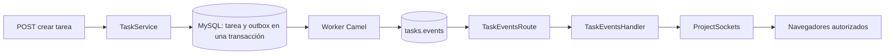

# Kafka, Camel y WebSocket en JavaOpenF

Este ejemplo contiene el recorrido completo para crear una tarea por HTTP, guardar su evento, publicarlo en Kafka y notificar a los navegadores del proyecto. Conserva Jersey, HK2, Hibernate y Tomcat. `TaskEventsHandler` pertenece a **`com.open_f.fu.workspace.messaging`**: es el adaptador del módulo workspace que interpreta los eventos de tareas.

Los archivos de esta carpeta son una capa de ejemplo sobre tu proyecto actual. **No se han cambiado el `src`, el `pom.xml` ni el Docker Compose de la raíz.** El script `prepare-example.ps1` genera una copia ejecutable en `.build` combinando tu código existente con estos archivos. No ejecutes Maven directamente en esta carpeta: solo contiene los archivos nuevos y los que hay que sustituir.

El recorrido es:



**Dónde está cada responsabilidad.** Las rutas dentro de este ejemplo se conservan al integrarlo en la raíz del proyecto:

| Paquete / archivo | Función |
|---|---|
| `workspace.service.TaskService` | Guarda la tarea y llama a `TaskEvents.created` dentro de su transacción |
| `workspace.domain.interfaces.TaskEvents` | Contrato para registrar el evento sin conocer Kafka |
| `workspace.messaging.OutboxTaskEvents` | Implementa el contrato y guarda el evento en el outbox |
| `workspace.messaging.TaskCreatedEvent` | JSON del evento, con ID único, versión, proyecto y datos |
| **`workspace.messaging.TaskEventsHandler`** | Valida el evento y llama al broadcast del proyecto |
| `workspace.messaging.TaskEventsRoute` | Suscripción Camel a `tasks.events`, reintentos, DLT y commits |
| `workspace.service.ProjectAccessService` | Comprueba el propietario y consulta las columnas |
| `workspace.api.ProjectRealtimeResource` | HTTP para consultar el estado y crear tareas |
| `shared.messaging.OutboxEvent` / `OutboxStore` | Entidad JPA y publicación de los eventos pendientes |
| `shared.messaging.KafkaPublisher` | Productor Kafka reutilizado; espera confirmación desde el worker |
| `shared.messaging.KafkaSettings` | Variables de entorno y nombres de topics |
| `shared.messaging.RealtimeServices` | Crea y comparte Camel, publicador, outbox, handler y hub |
| `shared.realtime.ProjectSockets` | Sesiones autenticadas y suscripciones a proyectos |
| `shared.realtime.WebSocketSender` | Envía en orden con una cola limitada por conexión |
| `shared.realtime.EventsEndpoint` | Recibe comandos WebSocket |
| `shared.realtime.EventsEndpointConfigurator` | Verifica el Origin y crea endpoints con el hub compartido |
| `config.RealtimeBootstrapListener` | Arranca y detiene la infraestructura con Tomcat |
| `config.RealtimeServicesFactory` | Entrega a HK2 la instancia creada por el listener |
| `config.SharedBinder` | Registra esa fábrica y la implementación de `TaskEvents` |
| `shared.security.JwtService` | Reutiliza el JWT de la aplicación, con secreto por entorno |
| `WEB-INF/web.xml` | Registra el listener después del de persistencia |
| `realtime-demo.html` | Cliente de prueba con login, suscripción, tareas y reconexión |

**1. Preparar una copia ejecutable.** Desde PowerShell, en la raíz del repo:

```powershell
Set-Location D:\Dev\JavaOpenF
$demoBuild = & .\examples\kafka-websocket\prepare-example.ps1
Write-Output $demoBuild
```

La ruta impresa es la copia completa. Los archivos nuevos y los reemplazos están bajo `examples/kafka-websocket/src`; los demás proceden del `src` actual. Si cambias un archivo del ejemplo, vuelve a preparar una copia para recoger el cambio. No se borra ninguna copia anterior.

**2. Iniciar MySQL y Kafka.** La configuración utiliza un broker Kafka con KRaft y almacenamiento persistente. Es una configuración local, sin alta disponibilidad ni TLS, basada en el [ejemplo oficial de Apache Kafka](https://github.com/apache/kafka/blob/trunk/docker/examples/docker-compose-files/single-node/plaintext/docker-compose.yml).

Si ya levantaste MySQL con el Compose de la raíz, puedes conservarlo y arrancar solo Kafka desde esa raíz:

```powershell
docker compose -f .\examples\kafka-websocket\docker-compose.yml -p javaopenf-kafka-demo up -d kafka kafka_init
```

Si MySQL no está iniciado, levanta primero el servicio original:

```powershell
docker compose up -d data_db
```

El contenedor `kafka_init` termina con código 0 tras crear `tasks.events` y `tasks.events.dlt`. Ambos tienen tres particiones y una réplica. Verifica su estado:

```powershell
docker compose -f .\examples\kafka-websocket\docker-compose.yml -p javaopenf-kafka-demo ps -a
```

Kafka debe estar `healthy` y `kafka_init` en `Exited (0)`. Se usa el MySQL actual, con la configuración de persistencia que ya tiene el repo. Hibernate creará la tabla nueva `outbox_events` porque está configurado con `hbm2ddl.auto=update`. Para probar sobre otra base, cambia las dos URL JDBC y las credenciales en el `persistence.xml` de la copia antes de desplegarla.

**3. Configurar Tomcat.** En las variables de entorno de su Run Configuration en IntelliJ:

```text
KAFKA_BOOTSTRAP_SERVERS=localhost:9092
REALTIME_INSTANCE_ID=local
REALTIME_ALLOWED_ORIGINS=http://localhost:8080,http://127.0.0.1:8080
JWT_SECRET=un-secreto-local-de-ejemplo-con-mas-de-32-caracteres
```

El secreto mostrado es solo de desarrollo; elige uno propio. El JWT del login REST y el de WebSocket usan el mismo `JwtService`. Los tokens emitidos antes de cambiar el secreto dejan de ser válidos: inicia sesión otra vez. El filtro JWT de Jersey no protege automáticamente el endpoint WebSocket; por eso el primer mensaje del socket autentica la conexión.

Si Tomcat usa otro puerto o dominio, ajusta `REALTIME_ALLOWED_ORIGINS` al origen exacto de la página. Con HTTPS, el navegador utilizará WSS. Tomcat sigue sirviendo el WebSocket en el mismo puerto HTTP/HTTPS de la aplicación.

**4. Compilar la copia.** Si Maven y Java 21 están en PATH:

```powershell
mvn -f "$demoBuild\pom.xml" -B package
```

En este equipo también puedes usar las instalaciones existentes:

```powershell
$env:JAVA_HOME = 'C:\Users\koyo\AppData\Local\mise\installs\java\21.0.2'
$env:PATH = "$env:JAVA_HOME\bin;$env:PATH"
& 'C:\Users\koyo\AppData\Local\mise\installs\maven\3.9.16\apache-maven-3.9.16\bin\mvn.cmd' -f "$demoBuild\pom.xml" -B package
```

Se conserva el único test JUnit/Mockito existente. No se añaden tests nuevos. El resultado está en `$demoBuild\target\open_f.war`.

**5. Desplegar el WAR del ejemplo.** En Deployment de la configuración de Tomcat, añade como fuente externa el WAR generado y utiliza, por ejemplo, el contexto `/open_f_kafka`. Evita desplegar a la vez dos artefactos con el mismo contexto. La configuración existente de `/open_f` puede seguir apuntando a tu aplicación actual.

Abre la página del ejemplo:

```text
http://localhost:8080/open_f_kafka/realtime-demo.html
```

La URL WebSocket será `ws://localhost:8080/open_f_kafka/ws/events`. La API REST conserva el prefijo `/api`. El endpoint WebSocket se registra programáticamente en `RealtimeBootstrapListener`; no hay que registrarlo en `RestApplication` ni añadir `@ServerEndpoint` a la clase.

**6. Probar el recorrido.**

1. Registra una cuenta de prueba en la página o entra con una existente.
2. Crea un proyecto. Copia el ID que aparece.
3. Conecta el WebSocket de esa pestaña al proyecto.
4. Abre una segunda pestaña, entra con la misma cuenta, escribe el mismo ID y conecta.
5. Crea una tarea desde la primera pestaña.
6. Ambas deben mostrar `task.created` en el registro y actualizar su listado.

El navegador usa estas rutas:

| Acción | Ruta relativa al contexto del WAR |
|---|---|
| Registrar | `POST /api/users/register` |
| Login | `POST /api/users/login` |
| Crear proyecto | `POST /api/project` |
| Estado del proyecto | `GET /api/realtime/projects/{projectId}` |
| Crear tarea | `POST /api/realtime/projects/{projectId}/columns/{columnId}/tasks` |
| WebSocket | `/ws/events` |

Ejemplo del body HTTP al crear una tarea:

```json
{"title":"Notificar cambios","description":"Ejemplo","priority":"MEDIUM"}
```

La página envía el JWT mediante `Authorization: Bearer ...` en HTTP. En WebSocket utiliza mensajes de aplicación, sin poner el token en la URL:

```json
{"type":"authenticate","token":"JWT_DEL_LOGIN"}
```

Tras recibir `authenticated`, envía:

```json
{"type":"subscribe","projectId":7}
```

El evento que recibe el cliente tiene esta forma:

```json
{
  "eventId":"66800c84-396b-42ec-9b11-a4d6e34d7be4",
  "type":"task.created",
  "version":1,
  "projectId":7,
  "occurredAt":"2026-11-15T20:00:00Z",
  "data":{
    "id":42,"code":"ABC123","title":"Notificar cambios",
    "description":"Ejemplo","priority":"MEDIUM","positionY":100.0,
    "columnId":2,"userId":3
  }
}
```

**7. Observar Kafka por separado.** Desde la raíz del repo, deja este comando escuchando mientras creas tareas:

```powershell
docker compose -f .\examples\kafka-websocket\docker-compose.yml -p javaopenf-kafka-demo exec kafka /opt/kafka/bin/kafka-console-consumer.sh --bootstrap-server kafka:19092 --topic tasks.events --from-beginning
```

Para observar los eventos que no cumplen el esquema, cambia el topic a `tasks.events.dlt`. El uso de topics, productores y consumidores sigue el [inicio rápido oficial](https://kafka.apache.org/quickstart/).

**Qué ocurre ante fallos.** `TaskService` guarda la tarea y el registro de outbox dentro de la misma transacción. El timer de Camel publica los registros pendientes y solo los elimina cuando Kafka confirma. Si Kafka está temporalmente caído, la petición puede seguir guardando tareas y los eventos quedan pendientes. Un reinicio entre publicar y eliminar puede repetir el evento: por eso conservamos `eventId`. Esta es una aplicación del [patrón outbox](https://debezium.io/documentation/reference/stable/transformations/outbox-event-router.html).

`TaskEventsRoute` procesa y confirma en el hilo del consumidor. Los JSON inválidos van a DLT y se confirma el origen después de publicar allí. Los fallos transitorios tienen tres reintentos locales; si persisten, el registro queda sin confirmar y el consumidor lo vuelve a intentar. La configuración de commits y errores procede del [componente Kafka de Camel](https://camel.apache.org/components/4.22.x/kafka-component.html). No se usan `threads()` ni procesamiento paralelo entre consumir y confirmar.

Confirmar Kafka significa que la instancia procesó el evento y lo puso en las colas de sus conexiones interesadas; **no confirma que un navegador lo haya recibido o mostrado**. El cliente recupera el estado por HTTP al suscribirse, al reconectar y tras `task.created`. Usa el snapshot como estado actual y limita la deduplicación de eventos a 1.000 IDs. Así evita reconstruir tareas obsoletas al releer eventos antiguos.

**Permisos y varias instancias.** El ejemplo permite suscribirse y crear tareas solo al propietario. El modelo actual no tiene membresías definidas; cuando existan, cambia la política de `ProjectAccessService` y el filtro de `ProjectSockets.broadcast` conjuntamente. Se verifica el permiso al suscribirse y al enviar cada evento. Las conexiones sin autenticar se cierran, los JWT expiran y los clientes lentos tienen colas limitadas. La configuración programática utiliza las capacidades de [Jakarta WebSocket](https://jakarta.ee/specifications/websocket/2.2/jakarta-websocket-spec-2.2).

Cada instancia que mantiene sus propios WebSocket necesita un `REALTIME_INSTANCE_ID` distinto: `node-a`, `node-b`, etc. Así genera grupos Kafka distintos y cada nodo recibe los eventos. Si comparten grupo, Kafka reparte las particiones entre ellos. [Grupos de consumidores](https://kafka.apache.org/44/javadoc/org/apache/kafka/clients/consumer/KafkaConsumer.html).

**Alcance de esta versión.** Publica las tareas creadas mediante `TaskService.create`. Las actualizaciones, movimientos y la tarjeta de bienvenida creada directamente por `ProjectService` no generan eventos todavía. Para añadirlos, crea contratos/eventos específicos y regístralos dentro de sus transacciones. El outbox conserva datos ante fallos, pero varios publicadores pueden publicar registros del mismo proyecto en distinto orden: la clave de Kafka ordena según la llegada a una partición, no según el commit de MySQL. Este ejemplo usa `task.created` y refresca el estado actual, sin asumir ese orden.

Antes de un despliegue real hay que definir las migraciones de esquema, las membresías, TLS/autenticación de Kafka, supervisión de las rutas, retención y capacidad. El Compose es deliberadamente local. El cierre de sesión de la página cierra su socket y elimina el token en memoria; no implementa revocación centralizada de JWT.

**Verificación realizada.** La copia compila con Java 21, genera el WAR y pasa el único test existente de `TaskService`. También se comprobaron el enlace de HK2, la resolución de la ruta Camel con el consumidor detenido y los metadatos de la entidad outbox. Docker estaba apagado durante la preparación: el recorrido vivo MySQL → Kafka → Camel → navegador queda pendiente de ejecutar con los pasos anteriores.

El archivo `ALL_CODE.md` reúne el contenido completo de los archivos de integración. Los archivos Java individuales conservan sus paquetes y todos sus imports para que puedas abrirlos y estudiarlos.
